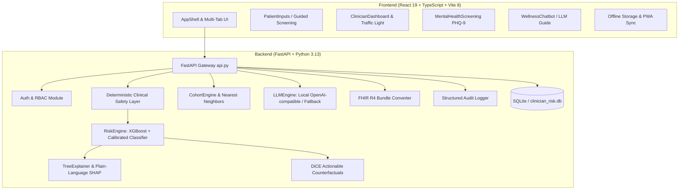

# Sanjeevni Healthcarer — Baseline Architecture Document

*Status: Baseline architectural snapshot before upgrade*  
*Target Persona: Rural Community Health Worker (ASHA-style) primary user, PHC Doctor secondary user, Admin audit oversight.*

---

## 1. System Overview

**Sanjeevni Healthcarer** is designed as an intelligent, explainable, and accessible clinical decision-support and screening platform for rural health settings. 



---

## 2. Component Inventory & Current State

### 2.1 Backend Services (`backend/`)
- **`backend/api.py`**: Central FastAPI application with CORS middleware, endpoints for `/predict`, `/explain`, `/simulate`, `/report`, `/mental-health-screen`, `/history`.
- **`backend/auth.py` & `backend/routes/auth.py`**: JWT-based authentication using bcrypt and PyJWT. Currently had hardcoded secrets and unmounted auth routes.
- **`backend/models/risk_engine.py`**: Ensemble ML predictor (`risk_pipeline_v1.joblib`). Contains preprocessing pipeline (BMI * Age, Glucose * HbA1c, cut categories) and SHAP KernelExplainer.
- **`backend/models/counterfactuals.py`**: Heuristic simulation scenarios (reducing BMI, lowering HbA1c, quitting smoking).
- **`backend/models/cohort_engine.py`**: Population statistics on `data/diabetes_dataset.csv` (100k records) using NearestNeighbors.
- **`backend/models/llm_engine.py` & `clinical_llm.py`**: LLM integration. Legacy clinical LLM attempted local GPT4All execution of a 4.4GB GGUF model; `llm_engine.py` targets OpenAI-compatible local endpoints (e.g., Ollama).
- **`backend/models/pdf_service.py`**: FPDF2-based clinical summary PDF generator.
- **`backend/utils/fhir_converter.py` & `backend/routes/fhir.py`**: Converts patient data and risk assessment into HL7 FHIR R4 Patient and RiskAssessment resources.
- **`backend/database.py` & `backend/models/user.py`**: SQLAlchemy SQLite database setup (`clinician_risk.db`).
- **`backend/services/history.py`**: JSON-backed patient assessment history with risk velocity calculation.

### 2.2 Frontend Application (`frontend/`)
- **Stack**: React 19, TypeScript, Vite 8, Tailwind CSS, Framer Motion, Recharts, Three.js / React Three Fiber.
- **Key Views**:
  - `App.tsx` & `AppShell.tsx`: Navigation shell, user profile menu, responsive layout.
  - `Login.tsx` & `Signup.tsx`: Authentication screens.
  - `PatientInputs.tsx`: Input form for patient clinical vitals.
  - `ClinicianDashboard.tsx`: Displays risk score, risk level gauge, risk drivers, and recommendation cards.
  - `MentalHealthScreening.tsx`: Clinically validated PHQ-9 depression screening tool with scoring, Indian crisis helplines, and counselling booking modal.
  - `WellnessChatbot.tsx`: Health Q&A interface covering metabolic health, diabetes, posture, and sleep.
  - `DigitalTwinModel.tsx`: 3D interactive human twin model.
  - `AuditLog.tsx`: Admin-only view for system logs.

### 2.3 Data & Machine Learning Artifacts (`data/`, `ml-research/`)
- **`data/diabetes_dataset.csv`**: Public Kaggle diabetes benchmark dataset with 100,992 records (Gender, Age, Hypertension, Heart Disease, Smoking History, BMI, HbA1c, Blood Glucose, Diabetes).
- **`backend/models/risk_pipeline_v1.joblib`**: Serialized scikit-learn voting classifier pipeline. Needs retraining to ensure zero-warning binary compatibility with scikit-learn 1.9+ and ultra-fast TreeExplainer support.

---

## 3. Product Architecture Alignment: Rural ASHA Health Worker

```
  ┌─────────────────────────────────────────────────────────────┐
  │                 5-Minute Guided Visit Flow                  │
  │                                                             │
  │  Step 1: Basic Vitals (Age, Gender, BMI / Height-Weight)    │
  │  Step 2: BP & Hypertension Flags (Systolic / Diastolic)     │
  │  Step 3: PHQ-9 Depression Screener (9 items)                │
  │                                                             │
  │                    ▼ Evaluation Engine                      │
  │       [ Deterministic Clinical Safety Layer ]               │
  │            (Emergency overrides: Red Alert)                 │
  │       [ Calibrated Tabular ML (XGBoost) ]                   │
  │            (Low / Moderate / High Risk)                     │
  │                                                             │
  │                      ▼ Actionable Triaging                  │
  │      🟢 GREEN: Community lifestyle / Home care advice       │
  │      🟡 YELLOW: Refer to Primary Health Centre soon         │
  │      🔴 RED: IMMEDIATE Doctor Referral / Emergency Hospital │
  └─────────────────────────────────────────────────────────────┘
```

1. **Lightweight Execution**: Optimized for 1 GB RAM PC and low-end mobile devices (PWA, offline IndexedDB sync, local lightweight fallback).
2. **Deterministic Safety Layer**: Immediate escalation to RED for clinical crises (e.g., Blood Glucose > 300 mg/dL, Hypertensive crisis BP > 180/120, or positive PHQ-9 Item 9).
3. **Local LLM Layer**: Configurable OpenAI-compatible local GPU endpoint with template fallbacks and medical grounding from public guideline snippets.
4. **Bilingual & Voice-Enabled**: Full English and Hindi support with Web Speech API input and speech synthesis output.
